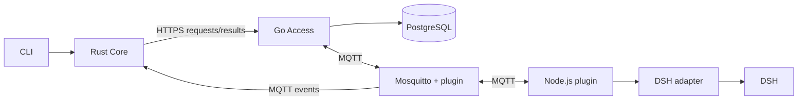

# WhaleRein Architecture

WhaleRein remotely operates existing DeepSeek Harness (DSH) sessions: session
queries, live output, messages, tool approvals, interruption, and recovery.
The first version targets one host, one CLI, and one server stack.

## Components



| Component | Code | Architecture |
|---|---|---|
| Shared Host | `host/runtime/` | [Source-independent runtime](../host/runtime/README.md) |
| Core | `core/` | [Client protocol, cache, synchronization](architecture/core.md) |
| CLI | `apps/cli/` | [Arguments, dispatch, output](architecture/cli.md) |
| Access | `access/` | [Authorization, persistence, relay](architecture/access.md) |
| DSH plugin | `host/dsh/` | [Execution, adapter, events](architecture/dsh-plugin.md) |

Core is self-contained Rust with `SecretStore` as its only injected capability.
All DSH APIs, credentials, projections, and subscriptions stay behind the plugin
adapter. Access is a Go monolith backed by PostgreSQL; forwarding work uses the
same database. Deployment configuration stays in `deploy/`.

## State ownership

| Fact | Authority | Copies |
|---|---|---|
| Session content and actions | DSH | Core caches session data. |
| Command execution and deduplication | Plugin | Access stores status; Core stores a projection. |
| Source history view/cursor | DSH adapter | Core stores an applied opaque cursor. |
| Transport grants and revocation | Access | Plugin applies revocation notices. |
| MQTT connection | Broker | Access derives presence. |
| Client connection/channel | Core runtime | Memory only. |

## Request and event paths

```text
Request: Core --HTTPS--> Access/PostgreSQL --MQTT--> Plugin
Result:  Plugin --MQTT--> Access/PostgreSQL --HTTPS polling--> Core
Event:   Plugin --MQTT--> Access --MQTT device topic--> Core
```

After pairing, handshakes, queries, controls, and synchronization all use
`POST /v1/hosts/{host_id}/requests`. Results are read by `request_id` through
`GET /v1/requests/{request_id}`. Session operations have no separate HTTP routes.
The plugin opens outbound connections and no HTTP listener.

[`whalerein.proto`](../proto/v1/whalerein.proto) is the only message schema:
proto3 JSON over HTTPS, binary protobuf over MQTT. The
[wire contract](../proto/v1/WIRE.md) defines topics, framing, errors, and IDs.

| Field | Purpose |
|---|---|
| `request_id` | Request/result correlation. |
| `command_id` + `payload_digest` | Control idempotency; a changed digest is rejected. |
| `trace_id` | Diagnostic correlation only. |
| History cursor | Opaque Source-owned committed position. |
| Attempt reference | Live epoch plus generation identity; separate from committed Messages. |

```text
received      -> host_offline | rejected | host_accepted | succeeded | failed | unknown
host_accepted -> succeeded | failed | unknown
unknown       -> succeeded | failed
```

`received` means Access accepted forwarding responsibility; `host_accepted` means
the plugin accepted a control. Neither implies completion. `unknown` means an
unconfirmed outcome. `host_offline`, `rejected`, `succeeded`, and `failed` are final.

## Security and recovery

Core and the plugin use Noise XX with X25519, ChaCha20-Poly1305, and SHA-256.
Pairing confirms the host fingerprint from the Noise key. Each reconnect creates
a fresh channel. Access and the broker see routing metadata, not application plaintext.
Public HTTPS and MQTT require TLS.

Access commits revocation before disconnecting the device and notifying hosts.
A reconnecting host waits for revocation replay before accepting new channels.
Core verifies token rejection with Access before clearing local pairing.

The plugin durably deduplicates controls. Unconfirmed commands after a crash
become `unknown` and are not automatically re-executed. Core fills event gaps or
replaces the cache with a snapshot. Offline operation is read-only.

## Deployment

The [Compose stack](../deploy/README.md) runs Access, PostgreSQL 18, and Mosquitto 2.1.2
with loopback plaintext development ports. The plugin runs on the DSH host.
Production TLS must be configured separately; clients use advertised endpoints.

## Access operating modes

The [Access deployment and identity redesign](architecture/access-evolution.md)
defines two operating modes in the same open-source Access program: Standalone
mode with local administration and invitation pairing, and External account mode
using an official or operator-provided account service through a public protocol.
Both can be self-hosted. Standalone mode runs in one process with durable pairing
recovery and versioned local state. External accounts and separate API/relay
deployment roles are later design targets, not implemented capabilities.

See [security](security.md) for trust/credential rules and [testing](testing.md)
for validation requirements.
