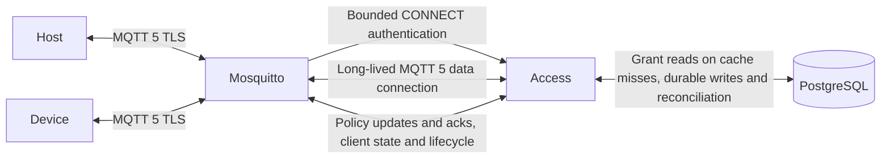

# Design

## Context

Access currently forwards events via MQTT using the broker interfaces in
`access/internal/broker`. Its EMQX integration uses HTTP callbacks for
authentication, ACLs and presence, and the EMQX management API for client
state and disconnects. Event admission and device subscription and receipt
checks can query PostgreSQL. Pairing and revocation already use committed
state in PostgreSQL. The replacement keeps these service boundaries and
changes how decisions reach the two realtime paths.

## Goals / Non-Goals

**Goals**

- Preserve existing clients, encryption, framing, recovery and claim behavior.
- Authorize warmed streaming traffic from local state in Access and Mosquitto.
- Leave one independent deployment unit with a single active Access and a
  single Mosquitto. Keep PostgreSQL external and authoritative.

**Non-Goals**

- Central line assignment, automatic line migration, broker clustering,
  multiple active Access instances in one line, and preview protocol changes.

## Decisions

### Architecture

Clients use their existing endpoint and credentials. Mosquitto owns MQTT
connections, topic routing and local ACL enforcement. Access owns identity
validation, grant admission, event routing, presence translation and broker
policy reconciliation. PostgreSQL owns durable grants, pairing, revocations
and existing command and history state. Access publishes and subscribes as
an internal MQTT service identity. That identity and the management commands
use a private, authenticated interface with their own access rules.
[Access architecture](../../../docs/architecture/access.md)

### Realtime admission

1. An external client connects. Mosquitto delegates credential and client ID
   validation to Access over a bounded private path. The result is bound to
   the broker connection. The internal Access MQTT identity can authenticate
   independently so startup and recovery can establish the control path.
2. Access loads the applicable grant on first use, preferably while preparing
   policy from a newly committed grant or during startup reconciliation. A
   device subscription uses Mosquitto's local policy. A cold Access event
   check may await a bounded database lookup. Access uses the Otter v2
   loading API to coalesce concurrent misses by Host and device. Cache
   limits and expiry are configured and exercised. Entries hold grant state
   and revision data and exclude credentials. Failed loads fail closed.
3. For a warmed grant, Access checks the cached revision and local deny state
   before dispatching each event or accepting a receipt. Mosquitto checks
   publication, subscription, delivery and Will permissions against its
   local policy. Access bounds any cold lookup and queued work so unrelated
   warmed grants can continue. Check the current Paho callback path during
   implementation, including a stalled cold load on shared subscriptions.
4. Existing HTTP and connection work can read committed PostgreSQL where the
   operation requires it. Transport keeps the existing MQTT QoS, opaque AEAD
   envelopes, 60 KiB logical parts and 16 MiB logical message limit.
   `complete=true` keeps its transport receipt meaning.
   [Otter v2.4.0](https://github.com/maypok86/otter/tree/v2.4.0)
   [Streaming contract](../../../docs/streaming.md)
   [Wire contract](../../../proto/v1/WIRE.md)

### Pairing, revocation and recovery

- Pair and re-pair use the existing transaction and operation identity.
  Publish an allow only from confirmed committed state. Reply with a usable
  pairing only after the matching Access admission and broker policy are
  ready. Retry converges from the same durable state.
- Revocation installs a scoped local deny before starting the PostgreSQL
  write and requests a broker deny promptly. Scope matches the operation
  (one Host and device, or the whole device). The deny lives outside the
  evictable cache. Invalidate affected entries and reject in-flight load
  results and queued dispatches superseded by the deny. Coordinate the
  revision and admission transition locally without holding locks across I/O.
  Already handed-off messages cannot be recalled.
- Complete revocation only when the PostgreSQL transaction has committed, the
  broker has acknowledged the matching deny and the superseded connection
  is closed or confirmed absent. Broker delivery checks also cover existing
  subscriptions. Detect confirmed rollback, uncertain commit and committed
  revocation awaiting broker enforcement. A confirmed rollback can reopen
  access only after authoritative reconciliation. An uncertain result keeps
  affected admission closed. A retry uses the existing operation identity
  and converges even if the previous response was lost.
- Compare every cache install and broker update against the applicable
  durable revisions and active connection identity. Existing persistence
  increments `grants.revocation_generation` for Host-scoped revocation,
  `devices.revocation_generation` for device-wide revocation and the grant
  generation for re-pairing. A late load, old update, delayed disconnect or
  retry cannot override a newer deny or pairing.
- Rebuild policy from PostgreSQL at broker startup with external access
  closed. Periodic reconciliation and retry also recover updates missed
  after commit. Reuse existing recovery and operation state or add a
  PostgreSQL-backed pending marker only if the existing state cannot
  distinguish required retries. Keep externally usable ACL state
  session-bound. A broker-local, bounded validity window expires if Access
  cannot confirm policy freshness. Do not renew uncertain policy. Fence
  affected scopes where known and the external listener when the scope is
  unknown. Continuously confirmed unrelated policy can keep serving. Record
  and test the broker validity interval and reconciliation bounds in the
  native feasibility work. Broker enforcement may lag during a partition.
  Access denies immediately and the operation remains incomplete until the
  broker confirms enforcement.

### Mosquitto integration

The selected native integration is the in-repo plugin built against pinned
Mosquitto 2.1.2. It authenticates the internal Access identity locally,
delegates external CONNECT validation to Access from worker threads, applies
the result in `MOSQ_EVT_TICK`, and keeps publish, subscribe, delivery and Will
decisions local. Access manages policy, presence snapshots and targeted
disconnects over `$CONTROL/whalerein/v1`. The full contract is documented in
[Mosquitto line](../docs/architecture/mosquitto.md).

Use a standard long-lived MQTT 5 data connection. Use upstream native
interfaces for authentication, management and ACLs where they satisfy this
contract. Dynamic Security was evaluated and rejected because it duplicates
device credentials in broker state and cannot perform deferred external
authentication. Its authentication handler can reject a known user with an invalid
password, client ID or disabled account. Plugin order and fall-through need
native verification before relying on it alongside Access authentication.
Avoid storing a duplicate copy of client credentials in broker policy.
[Dynamic Security authentication source](https://github.com/eclipse-mosquitto/mosquitto/blob/v2.1.2/plugins/dynamic-security/auth.c)

If needed, use a small native plugin for the missing operations. Candidate
interfaces include deferred CONNECT authentication, synchronous local ACL
checks, connection notifications, snapshots and broker-native disconnect.
Run external credential validation off the broker event loop using the
supported deferral and completion APIs on the chosen release. Policy updates,
snapshot and disconnect operations must be authenticated, idempotent, bounded
and correlated to acknowledgements. Restrict the private management
interface to the Access principal. Provide only the local state and
management operations required by the contract.
[Mosquitto plugin API](https://github.com/eclipse-mosquitto/mosquitto/tree/v2.1.2/plugins)
[Dynamic Security documentation](https://mosquitto.org/documentation/dynamic-security/)

Reconcile presence by taking a broker connection snapshot with an ordering
boundary and applying later notifications. Track connection identity across
reconnects so a delayed disconnect affects only its own connection. Preserve
Host-scoped notifications and the current HTTP heartbeat, claim expiry and
claim release paths. Unknown connection state stays unknown until
reconciled.

### Cutover and rollback

1. Rehearse against representative state, preserving the endpoint, TLS
   identity, credentials and PostgreSQL data. Retain the previous release's
   immutable images and configuration. Keep schema compatibility for the
   rollback window, including written data and operation state.
2. Quiesce new admissions and drain eligible in-flight work. Record recovery
   status for unfinished commands. Stop the old line before activating the
   new one. Start Access and Mosquitto, reconcile current policy and verify
   internal readiness before reopening external traffic.
3. Verify reconnect without re-pairing, live and committed output, recovery,
   claim release and existing revocation enforcement. Rollback stops the new
   line before starting the previous release against current durable state.
   Rehearse that path with successful revocations and in-flight commands
   created after cutover. A stale database snapshot cannot be used to reopen
   traffic with outdated grants or command state.

### Decision Review

| ID | Choice and tradeoff | Recommendation | Status and basis | ACs |
| --- | --- | --- | --- | --- |
| D-01 | One independent line and hard cut incur a reconnect window and remove dual-broker maintenance. | One Access and Mosquitto per line with external PG. Preserve whole-release rollback. | CONFIRMED by the user's hard-cut and multi-machine direction. | AC-08, AC-09 |
| D-02 | Otter provides bounded caching and coalesced cold loads. Permission invalidation still needs domain logic. | Use Otter v2.4.0 for shared grant admission. | CONFIRMED by the choice to reuse Otter and established tools. | AC-01, AC-02, AC-04 |
| D-03 | Local checks keep database and network waits off the realtime path. Revocation still needs a durable write and broker confirmation. | Apply local deny immediately. Commit and reconcile on the grant-change path. | CONFIRMED by the user's authorization design direction. PostgreSQL ownership is CONSTRAINED by project rules. | AC-01, AC-03–AC-06 |
| D-04 | Preserve the MQTT and application contract while changing deployment and operator configuration. | Reuse clients, topic grammar, framing, presence and recovery contracts. | CONSTRAINED by existing wire and architecture contracts and the agreed migration scope. | AC-06–AC-08, AC-10, AC-11 |
| D-05 | Dynamic Security duplicates credentials in broker state and cannot defer CONNECT validation to Access. A narrow native plugin uses the pinned broker's supported hooks. | Pin Mosquitto 2.1.2 and build the in-repo plugin in `deploy/mosquitto/plugin`. Deferred CONNECT validation over a bounded private HTTP request, local revision-fenced ACLs, `$CONTROL/whalerein/v1` management, sequence-ordered snapshot and notifications, targeted kick. Validity 15 s by default. | CONFIRMED by native evidence on 2026-11-14: 13 native cases in `deploy/mosquitto/test`; see [Mosquitto line](../docs/architecture/mosquitto.md). | AC-04–AC-06, AC-10, AC-11 |
| D-06 | A target-line benchmark establishes first measurements before selecting numerical latency objectives. | Record measurements under the 2 vCPU, 4 GiB, external PostgreSQL and 2,000-connection profile without a latency pass threshold. | CONFIRMED by the user. | AC-09 |

### Acceptance Review

| AC | Expected behavior | Evidence | Source |
| --- | --- | --- | --- |
| AC-01 | Warmed event and receipt authorization makes no SQL or broker RPC calls. Stalled work leaves unrelated grants live. | Query and callback counters under concurrent traffic and injected lookup or write stalls. | [Warm authorization](specs/access-grant-admission/spec.md#scenario-ac-01-warm-grants-avoid-per-message-database-reads) |
| AC-02 | One active lookup per cold key with deny on absence or failure. | Go concurrent cache tests with expiry, eviction, timeout and restart. | [Cold authorization](specs/access-grant-admission/spec.md#scenario-ac-02-cold-grants-load-once-per-key-and-fail-closed) |
| AC-03 | Pairing and re-pairing are usable after both authorization paths are ready. | PostgreSQL and broker integration suite with interrupted apply and retry. | [Pairing](specs/access-grant-admission/spec.md#scenario-ac-03-pairing-becomes-usable-after-both-authorization-checks-are-ready) |
| AC-04 | Revoke immediately fences Access dispatch and requires durable broker-confirmed completion. | Controlled races, rollback, ambiguous commit, broker outage and active connection closure. | [Revocation](specs/access-grant-admission/spec.md#scenario-ac-04-revocation-stops-forwarding-and-survives-restart) |
| AC-05 | Restarts and stale updates cannot restore obsolete authority. | Real broker and Access restarts, control partition, delayed updates and unavailable PG. | [Reconciliation](specs/access-grant-admission/spec.md#scenario-ac-05-broker-permission-recovery-excludes-stale-authority) |
| AC-06 | MQTT identity, local publish, subscribe, delivery and Will ACLs work for existing clients. | Native broker tests with allow and deny cases and per-message callback counts. | [Local broker policy](specs/mosquitto-line-transport/spec.md#scenario-ac-06-mqtt-identity-and-acl-are-enforced-on-each-broker-operation) |
| AC-07 | Existing stream, receipts and committed recovery remain interoperable. | Current client builds and integration suite with disconnect, replay and duplicate or missing parts. | [Transport recovery](specs/mosquitto-line-transport/spec.md#scenario-ac-07-stream-and-committed-event-recovery-survive-broker-replacement) |
| AC-08 | Hard cut and whole-release rollback preserve current grants and live command state. | Repeatable staged cutover and rollback with paired clients and post-cutover revocation. | [Cutover](specs/mosquitto-line-transport/spec.md#scenario-ac-08-a-hard-cut-preserves-existing-enrollments) |
| AC-09 | Record actual capacity, latency and resource use on the target line with no latency pass threshold. | Reproducible target-host load run with streaming and reconnect phases. | [Performance](specs/mosquitto-line-transport/spec.md#scenario-ac-09-performance-is-measured-on-the-target-line) |
| AC-10 | Normal and forced disconnects release the right claim. Reconnect ordering and HTTP fallback remain correct. | Core and Host integration tests with process termination, reconnect and late disconnect. | [Presence lifecycle](specs/claim-presence/spec.md#scenario-ac-10-disconnect-and-revocation-update-the-current-connection) |
| AC-11 | Access restart rebuilds presence despite racing connection changes. | Access-only restart with broker sessions kept live and concurrent connections. | [Presence recovery](specs/claim-presence/spec.md#scenario-ac-11-access-restarts-while-authenticated-hosts-remain-connected) |

### Capability acceptance

- Access grant admission requires AC-01 through AC-05. The cache tests alone
  demonstrate local behavior and need real PostgreSQL and broker evidence
  for end-to-end grant changes.
- Mosquitto line transport requires AC-06 through AC-09 and the real-broker
  revocation and restart evidence from AC-04 and AC-05. Record the selected
  version, image digest and native test settings.
- Claim presence requires AC-10 and AC-11 with a real broker and Host.
- The production hard cut requires all three capabilities, the staged
  rollback exercise and the target-line record. A partial implementation
  can be reviewed independently and stays out of the live line.

## Risks / Trade-offs

- Cache invalidation by itself cannot serialize an in-flight database read
  with a durable revocation. Scoped denial and revision ordering close
  that race while preserving unrelated traffic.
- A broker can continue serving existing subscriptions during a broken
  control path until its local validity window expires. Confirm the bound
  and behavior with the selected native integration. Start or resume
  serving affected traffic only from reconciled policy.
- Native callback and management behavior can vary by Mosquitto release.
  Validate CONNECT, SUBSCRIBE, WRITE, outgoing READ and Will ordering and
  confirm connect, disconnect, client listing and selective kick behavior
  with actual clients. Treat upstream v2.1.2 as a review candidate and
  select the deployment pin using native evidence.
- Client session state is interrupted during the hard cut. Durable command
  and history recovery and the previous release's ability to read current
  PostgreSQL state are release checks.
